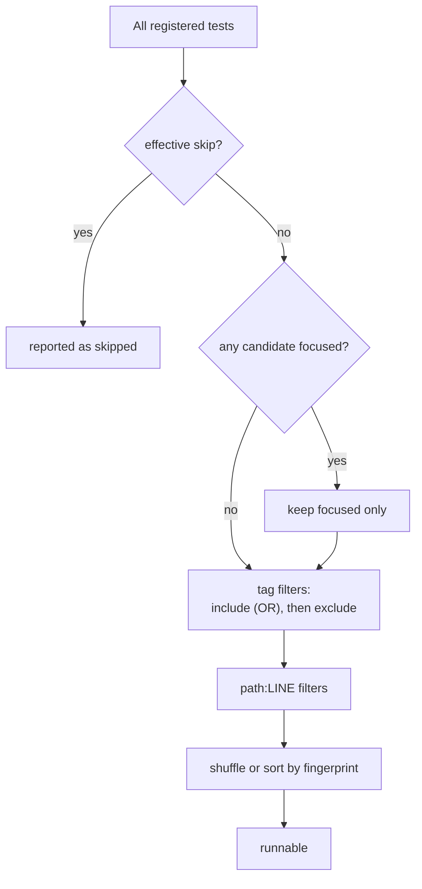
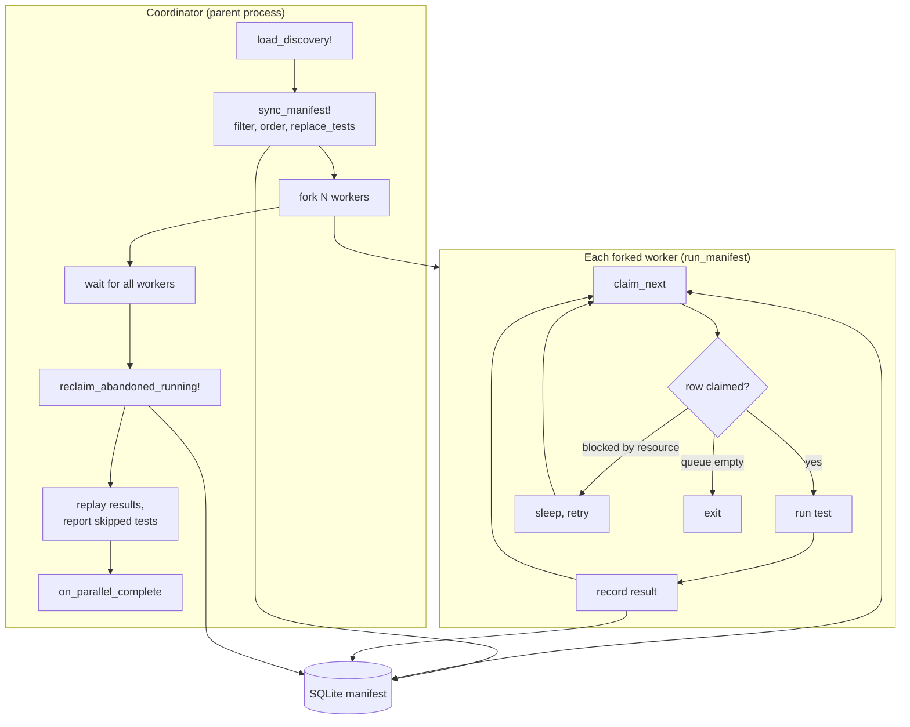
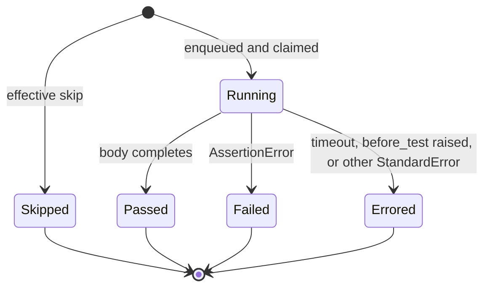

# Verity

Metadata-first Ruby tests. Each test is a structured record — description, tags, timeout, resource hints — registered at load time and synced into a SQLite manifest. The runner then executes the manifest, either in a single process or across forked workers that claim tests atomically from it as a work queue.

## Requirements

- Ruby ≥ 3.3
- `sqlite3` (~> 2.0) and `prism` (~> 1.0), installed as gem dependencies

## Installation

Add to your Gemfile:

```ruby
gem "verity"
```

Or build and install from a checkout:

```bash
gem build verity.gemspec && gem install verity-*.gem
```

## Quick start

Create `verity/math_test.rb` (the default discovery glob is `verity/**/*_test.rb`):

```ruby
test "addition works" do
  assert_equal actual: 1 + 1, expected: 2
end

group "Division", tags: [:math] do
  test "raises on zero" do
    assert_raises(ZeroDivisionError) { 1 / 0 }
  end

  test "floats are close enough", timeout: 1 do
    assert_in_delta actual: 0.1 + 0.2, expected: 0.3, delta: 1e-9
  end
end
```

Run it:

```bash
bundle exec verity
```

`test` and `group` are available at the top level of every discovery file — `require "verity"` mixes the DSL into `Object`.

## Writing tests

### `test`

```ruby
test(description, skip: false, focus: false, tags: [], timeout: nil, requires: [], **resources) { ... }
```

| Keyword | Meaning |
|---------|---------|
| `skip:` | `true` → never runs; reported as skipped |
| `focus:` | `true` → when any test is focused, only focused tests run (see [Selecting tests](#selecting-tests)) |
| `tags:` | Descriptive labels for filtering and CI (`[:slow, :integration]`). No reserved names — `:skip` / `:focus` in `tags:` do nothing |
| `timeout:` | Positive finite `Numeric` seconds, or `nil`. Validated at load time; exceeding it is an `:error` |
| `requires:` | Free-form dependency hints (e.g. `[:active_record]`). Stored as metadata only — nothing acts on it |
| `**resources` | Every other keyword. Used for [resource conflicts](#resource-conflicts) (e.g. `tables: [:users]`) |

Because unknown keywords land in `resources`, a typo such as `skipp: true` is silently accepted as a resource rather than raising.

### `group`

Nest tests under titled sections. `group` takes the same `skip:`, `focus:`, and `tags:` keywords and requires a block:

```ruby
group "Authentication", tags: [:integration] do
  group "sessions", focus: true do
    test "creates a session" do
      # ...
    end
  end
end

group "WIP", skip: true do
  test "not scheduled yet" do
  end
end
```

- `tags:` cascade to every nested test (outer groups first) and combine with the test's own tags — see `Verity.effective_tags(test)`.
- `skip:` and `focus:` cascade: a test's effective value is its own keyword OR any enclosing group's.
- Each test records its `group_path` (array of titles), which `DocumentationReporter` prints as an outline.
- The group stack is reset before each discovery file loads, so an unclosed `group` in one file can't leak into the next.

### Assertions

Assertions comparing two values take **keyword arguments**, not Minitest-style positional ones. Every assertion also accepts `message:` (a String, or a Proc evaluated only on failure).

| Assertion | Passes when |
|-----------|-------------|
| `assert(check)` / `refute(check)` | `check` is truthy / falsy |
| `assert_nil(actual)` / `refute_nil(actual)` | `actual.nil?` / not |
| `assert_equal(actual:, expected:)` / `refute_equal(...)` | `actual == expected` / not (failure shows a diff) |
| `assert_same(actual:, expected:)` / `refute_same(...)` | `actual.equal?(expected)` / not |
| `assert_match(pattern:, actual:)` / `refute_match(...)` | Regexp `=~`, or String `include?` / not |
| `assert_includes(item:, collection:)` / `refute_includes(...)` | `collection.include?(item)` / not |
| `assert_in_delta(expected:, actual:, delta:)` / `refute_in_delta(...)` | within `delta` (plus a float-epsilon tolerance) / not |
| `assert_raises(*classes, match: nil) { }` | block raises one of `classes` (at least one required); `match:` checks the message (String substring or Regexp). Returns the exception |
| `refute_raises(*classes, match: nil) { }` | block doesn't raise the listed classes (no classes → must not raise at all) |

A failed assertion raises `Verity::AssertionError` (status `:fail`); a timeout raises `Verity::TestTimeoutError` (status `:error`).

### Hooks

```ruby
Verity.before_worker_start { |worker_id| }  # once per worker process (or once in a single-process run)
Verity.before_test { }                      # before each test; raising makes the test :error
Verity.after_test { }                       # after each test, always; exceptions are warned and swallowed
```

Hooks are global and accumulate; there is no API to remove one.

### Resource conflicts

In parallel runs you can stop two tests that touch the same resource from running at the same time. Register a resolver, then tag tests with that resource keyword:

```ruby
Verity.register_resource :tables,
  conflicts_with: ->(mine, theirs) { (mine & theirs).any? }

test "creates a user", tables: [:users] do
  # ...
end
```

`mine` and `theirs` arrive as `Array<String>`. When the only pending tests conflict with tests that are already running, a worker sleeps briefly and retries. Conflict avoidance is best-effort: claiming isn't transactional with the conflict check, so two workers can occasionally start conflicting tests at the same moment.

## Running

```bash
./bin/verity           # from a checkout
bundle exec verity     # from an app that depends on the gem
```

| Option | Effect |
|--------|--------|
| `-w`, `--workers COUNT` | Parallel worker processes: a positive integer or `cpus` |
| `-t`, `--tag NAME` | Run only tests whose effective tags include `NAME`. Repeatable (OR). A leading `:` is optional |
| `--exclude-tag NAME` | Skip tests carrying `NAME`. Repeatable. Exclusion wins over inclusion |
| `-r`, `--reporter NAME` | Output reporter (see [Reporters](#reporters)) |
| `--order MODE` | `random` (default) or `fingerprint` (sorted, deterministic) |
| `--seed INTEGER` | Fix the shuffle seed. Forces shuffled order even with `--order fingerprint` |
| `-h`, `--help` | Print usage |

There is no `--version` flag; use `Verity::VERSION`.

### Choosing files and lines

Positional arguments replace the configured `test_globs`. Each is expanded with `File.expand_path` and passed to `Dir.glob`, so files and quoted globs both work:

```bash
verity verity/models/user_test.rb
verity 'verity/models/**/*_test.rb' verity/lib/auth_test.rb
verity verity/models/user_test.rb:42      # only the test or group defined on line 42
```

- Pass files or globs, not bare directories — `verity verity/` currently crashes. Use `verity 'verity/**/*_test.rb'`.
- `path:LINE` must point at the line of a `test` or `group` call. A line inside a test body matches nothing.
- A path that matches nothing runs zero tests and exits 0.

### Ordering

Tests run in random order by default. When the seed is chosen automatically it's printed to stderr as a bare integer before the run, so you can reproduce an order with `--seed N`.

### Exit status

| Code | Meaning |
|------|---------|
| `0` | Every executed test passed — including when no tests matched |
| `1` | At least one test failed or errored, or the run crashed (e.g. a `SyntaxError` in a test file, or `--seed` given a non-integer) |
| `2` | Invalid CLI option (unknown flag, bad `--order`, missing file in `path:LINE`) or an `ArgumentError` during load/run (unknown reporter, invalid `timeout:`, `:memory:` manifest with more than one worker) |

## Selecting tests

The runnable set is computed in this order:

1. **Skip** — tests whose effective `skip` is true are removed (and reported as skipped).
2. **Focus** — if any remaining test is focused, only focused tests stay. If every remaining test is focused, this step changes nothing.
3. **Tags** — `included_tags` / `--tag` keeps tests with any matching effective tag; then `excluded_tags` / `--exclude-tag` removes tests with any matching tag. Verity warns if inclusion matches nothing.
4. **Location** — `path:LINE` filters keep only tests at, or nested in a group at, those lines.
5. **Order** — shuffle (random) or sort by fingerprint.

A test with both `skip: true` and `focus: true` is skipped. Single-process summaries end with `(focus)` when focus narrowed the suite, and `(tags)` when a tag filter is set.



## Configuration

Call `Verity.configure` before `Verity.run`, typically from a helper loaded before discovery. The defaults:

```ruby
Verity.configure do |c|
  c.test_globs    = ["verity/**/*_test.rb"]
  c.manifest_path = "verity/manifest.db"   # relative to cwd; or ":memory:" (single worker only)
  c.worker_count  = :cpus                  # or a positive Integer
  c.reporter      = Verity::Reporters::ColoredDotsReporter.new($stdout)
  c.included_tags = []
  c.excluded_tags = []
  c.test_order    = :random                # or :fingerprint
  c.shuffle_seed  = nil                    # Integer to fix the order
end
```

- `test_globs`: patterns passed to `Dir.glob`. The matches are de-duplicated and sorted into `test_files`.
- `manifest_path`: the SQLite database file. Add it to your `.gitignore`. A `":memory:"` manifest needs `worker_count = 1` set explicitly, because the default is parallel.
- `worker_count`: `:cpus` (or `:cpu`, `"cpus"`, `"cpu"`) means `Etc.nprocessors`. The default makes runs parallel on any multi-core machine (see [Parallel runs](#parallel-runs)). Parallel runs need a file manifest and `Kernel#fork`.
- `included_tags` / `excluded_tags`: arrays of tag names. Strings are converted to Symbols.

Lower-level entry points:

- `Verity.run`: loads `test_files`, syncs the runnable set into the manifest, and runs it.
- `Verity.load_discovery!`: only clears the registry and loads `test_files`. Use it when building your own harness.

## Reporters

Pick one with `-r NAME` or `c.reporter = ...`. The built-in names are case-insensitive:

| Name | Class | Output |
|------|-------|--------|
| `colored`, `colored_dots` (default) | `ColoredDotsReporter` | `.` pass, `F` fail, `E` error, `S` skip, colored when stdout is a TTY |
| `dots` | `DotsReporter` | the same characters, no color |
| `documentation`, `doc` | `DocumentationReporter` | an outline of group titles and test descriptions, colored on a TTY |
| `null`, `none`, `silent` | `NullReporter` | nothing |

Color can be controlled from the environment:

- `NO_COLOR` turns color off when it is set to any value, and takes precedence.
- `FORCE_COLOR` or `VERITY_FORCE_COLOR` set to `1`, `true` or `yes` turns color on even when stdout isn't a TTY.

Two more classes ship with Verity:

- `CompositeReporter.new(*reporters)` fans each callback out to several reporters.
- `TestReporter` records every callback in memory (see below).

### Custom reporters

On the command line, pass `-r path/to/file.rb:ClassName`. Verity `load`s the file and calls `ClassName.new` with no arguments. The class must `include Verity::Reporter`:

```ruby
class MyReporter
  include Verity::Reporter

  def on_run_start(total:, worker_id:)
    # total: expected number of tests (nil if unknown)
  end

  def on_test_complete(result:, worker_id:)
    # result.test (a Verity::Test), result.status (:pass | :fail | :error | :skip), result.error
  end

  def on_run_finish(summary:, worker_id:)
    # summary keys: :total, :passed, :failed, :errored, :skipped, :focus, :tag_filter
  end

  # Called instead of on_run_finish after a parallel run (coordinator process only).
  # counts: {"passed", "failed", "errored", "skipped", ...} => Integer
  # problem_rows: [{ fingerprint:, description:, status:, failure: }, ...]
  def on_parallel_complete(counts:, problem_rows:)
  end
end
```

`result.test` is a `Verity::Test` (a `Data` struct):

| Field | Description |
|-------|-------------|
| `fingerprint` | Identity string, used for `--order fingerprint` and in failure reports |
| `description` | The string passed to `test` |
| `skip`, `focus` | Effective booleans (own keyword OR any enclosing group's) |
| `tags` | The test's own `tags:` |
| `timeout` | `Numeric` seconds or `nil` |
| `requires` | Declared hints |
| `resources` | Extra keywords, e.g. `{ tables: [:users] }` |
| `file`, `line` | Location of the `test` call |
| `fn` | The test body |
| `group_path` | Enclosing `group` titles, outermost first |
| `inherited_group_tags` | Tags from enclosing groups, outermost first |
| `group_scopes` | `GroupScope` (`title`, `file`, `line`) for each enclosing group, used by `path:LINE` |

### TestReporter

`Verity::Reporters::TestReporter` records every callback in memory, which is useful for testing integrations:

```ruby
reporter = Verity::Reporters::TestReporter.new
Verity.configure { |c| c.reporter = reporter }
Verity.run
reporter.test_completes.count { _1[:status] == :pass }
```

| Reader | Entries |
|--------|---------|
| `run_starts` | `{ total:, worker_id: }` |
| `test_completes` | `{ status:, error:, worker_id: }` |
| `run_finishes` | `{ summary:, worker_id: }` |
| `parallel_finishes` | `{ counts:, problem_rows: }` |

## Execution model

### Parallel runs

When `worker_count > 1`, the coordinator:

1. loads the discovery files;
2. writes the runnable set into the SQLite manifest;
3. forks the workers.

Each worker claims one `pending` row at a time, marking it `running`, then runs the test and records the result. When the queue is empty the worker exits.

After all workers exit, the coordinator does three things:

1. It marks any row still `running` (left by a crashed worker) as errored.
2. It replays every recorded result through the reporter.
3. It calls `on_parallel_complete`.



Workers report to a `NullReporter`, and all output comes from the replay. Replayed results differ from single-process results in a few ways:

- `on_run_finish` isn't called. `on_parallel_complete` replaces it, so the built-in dots/documentation summary line (including `(focus)` and `(tags)`) doesn't appear.
- Replayed `Verity::Test` objects have empty `group_path`, `inherited_group_tags` and `group_scopes`. The documentation reporter therefore prints no group headings.
- Errors are rebuilt as `RuntimeError` with the message `"OriginalClass: message"`.

Run with `-w 1` if you need the full single-process reporting.

### A test's outcome



Only `StandardError` is rescued. An `exit` or `Interrupt` inside a test kills the worker. In a parallel run, that test is then reported as errored ("abandoned").

## Rails applications

Verity includes the following Rails pieces:

- an install generator;
- an adapter (`require "verity/rails"`) that adds transactional tests, reconnect-after-fork, fixtures, integration sessions and Rails test helpers;
- a Railtie that defines the `rake verity` and `rake verity:run` tasks.

### Setup

1. Add `gem "verity"` to the Gemfile (in the test group).
2. Run `bin/rails generate verity:install`. It creates:
   - `test/verity_helper.rb`;
   - an executable `bin/verity`;
   - a sample test, `test/verity/sample_test.rb`.

   It also adds `tmp/verity_manifest.db` to `.gitignore`.
3. Write tests in `test/verity/**/*_test.rb`. See [`examples/rails/test/verity/users_test.rb`](examples/rails/test/verity/users_test.rb).
4. Run `bin/verity`. It loads the helper, then accepts every CLI option, e.g. `bin/verity -w 4 -t slow`.

`bundle exec verity` doesn't load `test/verity_helper.rb`, so in a Rails app use `bin/verity`.

### Rake task

The Railtie isn't loaded automatically yet. To get `rake verity`, require it in your `Rakefile` before tasks load:

```ruby
require_relative "config/application"
require "verity/railtie"
Rails.application.load_tasks
```

`bin/rake verity` boots `:environment`, loads `test/verity_helper.rb` and runs the suite. Rake treats extra arguments as task names, so don't pass CLI flags through rake. Use the environment variables the generated helper reads:

```bash
VERITY_WORKERS=4 bin/rake verity
VERITY_PER_WORKER_DB=1 bin/rake verity
```

### Helper

The generated `test/verity_helper.rb`:

```ruby
ENV["RAILS_ENV"] ||= "test"
require_relative "../config/environment"
require "verity/rails"

Verity.configure do |c|
  c.test_globs = ["test/verity/**/*_test.rb"]
  c.manifest_path = "tmp/verity_manifest.db"
  c.worker_count = ENV.fetch("VERITY_WORKERS", "cpus")
end

Verity::Rails.configure do |c|
  c.transactional_tests = true
  c.reconnect_after_fork = true
  c.per_worker_database = ENV["VERITY_PER_WORKER_DB"] == "1"
  c.fixture_sets = [] # e.g. [:users] or :all
  c.delegate_http_methods = false
end

Verity.register_resource :tables,
  conflicts_with: ->(mine, theirs) { (mine & theirs).any? }

Verity::Rails.install!
```

### `Verity::Rails.configure` options

| Option | Default | Effect |
|--------|---------|--------|
| `transactional_tests` | `false` | Wraps each test in a non-joinable transaction on the primary connection and rolls it back afterwards |
| `reconnect_after_fork` | `true` | Re-establishes the ActiveRecord connection in each worker (skipped when `per_worker_database` is on) |
| `per_worker_database` | `false` | Sets `TEST_ENV_NUMBER` (`""`, `"1"`, `"2"`, …) per worker and reconnects. Your `database.yml` must interpolate it, parallel_tests style |
| `fixture_sets` | `[]` | Fixture sets to load once per worker (`[:users]` or `:all`). Each set gets an accessor such as `users(:alice)`; the label defaults to `:one` |
| `fixture_path` | `nil` | Directory for fixtures; `nil` means `Rails.root/test/fixtures` |
| `integration_app` | `nil` | Rack app for `integration_session`; `nil` means `Rails.application` |
| `reset_integration_session_per_test` | `true` | Starts a fresh integration session for each test |
| `delegate_http_methods` | `false` | Defines top-level `get`, `post`, `patch`, `put`, `delete` and `head` that delegate to `integration_session` |

### Database isolation

With a shared test database, choose one of these:

- Use `transactional_tests` together with resource conflicts (`tables: [...]`, as registered in the generated helper).
- Enable `per_worker_database` and prepare one database per worker in CI.

Fixtures are loaded outside the per-test transaction, so they're committed to the database.

### Integration tests

Call `integration_session.get "/path"`, or turn on `delegate_http_methods`. In integration tests you can use:

- `assert_response` with `:success`, `:redirect`, `:missing`, `:error` or an Integer;
- `assert_redirected_to` with a String or a Regexp.

### Rails test helpers

When the relevant gems are loaded, `install!` mixes these modules into `Object`, so they're available in every `test` block:

- `ActiveSupport::Testing::TimeHelpers`
- `ActiveJob::TestHelper`
- `ActionMailer::TestHelper`

`install!` also sets `ActiveJob::Base.queue_adapter = :test`. After each test, `after_test` runs `travel_back`, clears enqueued jobs, and clears `ActionMailer::Base.deliveries`.

### Limitations

- **Rails assertion helpers.** Rails' helpers call `assert_equal a, b` positionally, and Verity's `assert_equal` takes keywords. As a result, these currently raise `ArgumentError`:
  - `assert_difference`
  - `assert_enqueued_jobs`
  - `assert_performed_jobs`
  - `assert_enqueued_with`
  - `assert_emails`

  Non-asserting helpers work: `travel_to`, `freeze_time`, `perform_enqueued_jobs`.
- **`assert_raises` is shadowed.** Including `ActiveSupport::Testing::Assertions` replaces Verity's `assert_raises` with Rails' version, which has no `match:` keyword.
- **Methods on `Object`.** Every helper above is defined on every object. A receiver that lacks a method of the same name, such as a stray implicit `get`, silently resolves to the helper instead of raising `NoMethodError`.
- **No system, controller or Capybara tests.** Keep those on `ActionDispatch::SystemTestCase` or `ActionController::TestCase`.

## Known limitations

- Tests defined in a loop, such as `%w[a b].each { |n| test "t #{n}" do ... end }`, share a fingerprint. Syncing them into the manifest fails with `SQLite3::ConstraintException`.
- Fingerprints depend on the working directory, and tests inside any block, including `group`, get a fingerprint based on file and line. Running from a different directory or moving a test changes its identity. The manifest is rebuilt on every run, so today this only affects `--order fingerprint` and failure labels.

## Contributing

See [CONTRIBUTING.md](CONTRIBUTING.md). This repository tests Verity three ways, comparing the same scenarios across loaders and assertion styles:

| Suite | Location |
|-------|----------|
| Verity, using its own DSL | `verity/` |
| Minitest | `test/` |
| RSpec | `spec/verity/` |

Run all three with `bin/test_all`.

## License

MIT — see [LICENSE](LICENSE).
